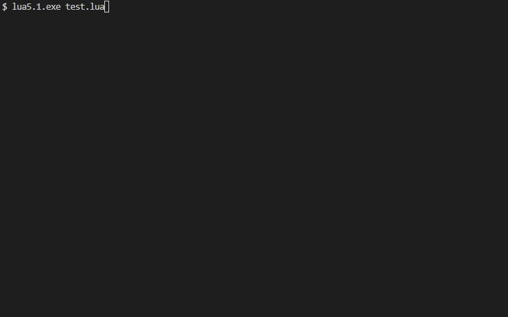

<div align="center">


# Jestronaut 

[](https://github.com/luttje/jestronaut/blob/main/LICENSE)
[](https://luarocks.org/modules/luttje/jestronaut)
[](https://github.com/luttje/jestronaut/actions/workflows/tests.yml)
[](https://libraries.io/github/luttje/jestronaut)
[](https://coveralls.io/github/luttje/jestronaut?branch=main)

</div>

A Lua library for testing your code. It does for Lua what [Jest](https://jestjs.io/) does for JavaScript, with a similar API. 

* `describe`, `it`/`test` and hooks, with `only`, `skip`, `todo`, `failing`, `each` and retries
* Jest's matchers, with readable failure messages that show where values differ
* Mock functions, spies and module mocking
* Asynchronous tests with a `done` callback, and fake timers
* A `jestronaut` command that finds and runs your test files, and exits with status code 1 when tests fail
* Lua 5.1 to 5.4, LuaJIT and [Garry's Mod](./gmod-addon/README.md)



## 🚀 Getting Started

1. Install Jestronaut with [LuaRocks](https://luarocks.org/):

    ```bash
    luarocks install jestronaut
    ```

2. Create a test file. Files ending in `_test.lua`, `_spec.lua`, `.test.lua` or `.spec.lua` are test files:

    ```lua
    -- tests/math_test.lua
    describe("math", function()
      it("adds numbers", function()
        expect(1 + 1):toBe(2)
      end)
    end)
    ```

3. Run the tests from the root of your project:

    ```bash
    jestronaut
    ```

## ▶️ Running tests

### With the `jestronaut` command

`jestronaut` finds the test files in the current directory (skipping hidden directories, `node_modules` and `lua_modules`) and runs them. Test files can `require` your project's modules relative to the current directory.

```bash
jestronaut                              # Run all test files
jestronaut tests/unit                   # Run the test files in a directory
jestronaut tests/math_test.lua          # Run a single test file
jestronaut math                         # Run the test files whose path contains "math"
jestronaut --testNamePattern="adds"     # Run the tests whose full name matches a Lua pattern
jestronaut --bail --verbose             # Stop at the first failure, and show every test
```

Run `jestronaut --help` for all options. They are the same as the [configuration options](#%EF%B8%8F-configuration), written as `--name=value`, `--name` (true) or `--no-name` (false). Options that take a list, like `--roots`, can be repeated.

Jestronaut exits with status code `1` when a test fails, so CI pipelines fail as expected. When the `CI` environment variable is set (as most CI services do) or `NO_COLOR` is set, it prints a plain log instead of redrawing its output.

### From Lua

To set Jestronaut up yourself, for example in an application that embeds Lua, create a runner file:

```lua
-- test.lua
require "jestronaut":withGlobals()

jestronaut
  :configure({
    roots = { "./tests/" },
  })
  :registerTests()
  :runTests()
```

`registerTests` finds the test files in the roots when called without arguments, which requires [LuaFileSystem](https://lunarmodules.github.io/luafilesystem/) (installed together with Jestronaut by LuaRocks). You can also give it a list of test files, or a function that loads them:

```lua
jestronaut
  :configure({ roots = { "./tests/" } })
  :registerTests(function()
    require "tests.math_test"
    require "tests.strings_test"
  end)
  :runTests()
```

If the host application should keep running when tests fail, set `exitOnFailure = false` and use the results passed to `runTests`:

```lua
jestronaut
  :configure({ roots = { "./tests/" }, exitOnFailure = false })
  :registerTests()
  :runTests(function(results)
    print(results.success, results.failedCount, results.skippedCount)
  end)
```

### With the standalone binary

The [releases page](https://github.com/luttje/jestronaut/releases) has a standalone `jestronaut` binary (built with [lit](https://luvit.io/)) for Linux and Windows. It works like the `jestronaut` command, without needing Lua or LuaRocks:

```bash
jestronaut tests/
```

> [!NOTE]
> On Windows with MSYS2 (for example Git Bash), set `MSYS_NO_PATHCONV=1` when passing patterns that start with a slash, like `--testPathIgnorePatterns="/generated/"`. Otherwise they are converted to Windows paths.

### In Garry's Mod

See [the Jestronaut Garry's Mod addon README](./gmod-addon/README.md).

## ✍️ Writing tests

The `jestronaut` command and `withGlobals()` make `describe`, `it`, `test`, `expect`, the hooks and `jestronaut` available as globals. To write tests without globals, get them from the module:

```lua
local jestronaut = require "jestronaut"
local describe, it, expect = jestronaut.describe, jestronaut.it, jestronaut.expect

describe("math", function()
  it("adds numbers", function()
    expect(1 + 1):toBe(2)
  end)
end)
```

## 🧪 API

Jestronaut tries to match [the API of Jest](https://jestjs.io/docs/api) as closely as possible. Here are some examples of how to use it:

```lua
describe("test organization into suites", function()
  it("should confirm basic math", function()
    expect(1 + 1):toBe(2)      
  end)
end)

it("should let sums NOT match", function()
  expect(1 + 1)['not']:toBe(3)
  expect(1 + 5)['not']:toBeGreaterThan(7)
end)

it("should have all the matchers Jest has", function()
  expect(1 + 1):toBe(2)
  expect(0.1 + 5.2):toBeCloseTo(5.3)
  expect({}):toBeDefined()
  expect(nil):toBeFalsy()
  expect(1 + 1):toBeGreaterThan(1)
  expect(1 + 1):toBeGreaterThanOrEqual(2)
  expect(1 + 1):toBeLessThan(3)
  expect(1 + 1):toBeLessThanOrEqual(2)
  expect(0/0):toBeNaN()
  expect(nil):toBeNil()
  expect(nil):toBeNull()
  expect(1 + 1):toBeTruthy()
  expect(1 + 1):toBeType('number')
  expect(nil):toBeUndefined()
  expect({1, 2, 3}):toContain(2)
  expect({1, 2, 3}):toContainEqual(2)
  expect({1, 2, 3}):toEqual({1, 2, 3})
  expect({1, 2, 3}):toHaveLength(3)
  expect({
    a = 1,
    b = 2,
    c = 3
  }):toHaveProperty('a')
  expect("abc"):toMatch("c$") -- Lua patterns
  expect({
    a = 1,
    b = 2,
    c = 3
  }):toMatchObject({
    a = 1,
    b = 2
  })
  expect({}):toStrictEqual({})
  expect(function() error('test') end):toThrow('test')
  expect(function() error('testing') end):toThrowError('testing')
end)

it('should be able to mock function implementations', function()
  local mockFn = jestronaut:fn(function() return 'x', 'y', 'z' end)
  mockFn(1, 2, 3)

  expect(mockFn):toHaveBeenCalled()
  expect(mockFn):toHaveBeenCalledTimes(1)
  expect(mockFn):toHaveBeenCalledWith(1, 2, 3)
  
  mockFn(3, 2, 1)
  expect(mockFn):toHaveBeenLastCalledWith(3, 2, 1)
  expect(mockFn):toHaveBeenNthCalledWith(1, 1, 2, 3)
  expect(mockFn):toHaveLastReturnedWith('x', 'y', 'z')
  expect(mockFn):toHaveNthReturnedWith(1, 'x', 'y', 'z')
  expect(mockFn):toHaveReturned()
  expect(mockFn):toHaveReturnedTimes(2)
  expect(mockFn):toHaveReturnedWith('x', 'y', 'z')
end)

local ranBefore = 0
beforeAll(function()
  ranBefore = ranBefore + 1
end)

it('runs beforeAll once, before the first test in its scope', function()
  expect(ranBefore):toEqual(1)
end)

it('can spy on a property setter', function()
  local audio = {
    volume = 0,
  }
  local spy = jestronaut:spyOn(audio, 'volume', 'set')
  audio.volume = 100

  expect(spy):toHaveBeenCalled()
  expect(audio.volume):toBe(100)
end)

it('can spy on a property getter', function()
  local audio = {
    volume = 0,
  }
  local spy = jestronaut:spyOn(audio, 'volume', 'get')
  print(audio.volume)

  expect(spy):toHaveBeenCalled()
  expect(audio.volume):toBe(0)
end)

it:failing('should be able to expected failures', function()
  expect(1 + 1):toEqual(1)
end)

it:skip('should be able to skip tests', function()
  expect(1 + 1):toEqual(1)
end)

it:each({{1, 1, 2}, {1, 2, 3}, {2, 1, 3}})(
  "can loop data (%i, %i = %i)",
  function(a, b, expected)
    expect(a + b):toBe(expected)
  end
)
```

Check out [the Jestronaut tests](https://github.com/luttje/jestronaut/tree/main/tests) for more examples.

### Tests and hooks

| Function | Description |
| --- | --- |
| `describe(name, fn)` | Groups tests. `describe:only`, `describe:skip` and `describe:each` work like the test versions. |
| `it(name, fn, timeout)`, `test(...)` | A test. `timeout` (milliseconds) applies to tests that take `done`. |
| `it:only(...)` | Only run the tests marked `only` in the test file. |
| `it:skip(...)` | Skip the test. |
| `it:todo(name)` | A test that is still to be written. |
| `it:failing(...)` | A test that passes when it fails. Also `it.failing:only` and `it.failing:skip`. |
| `it:each(table)(name, fn)` | A test for each item. The name can use `%s`, `%d`, `%i`, `%f`, `%j`, `%o`, `%p`, `%#` and `$variable`. |
| `it.concurrent(...)` | Supported, but runs like `it`: tests run one after another. |
| `beforeAll(fn)`, `afterAll(fn)` | Run once before the first and after the last test in their file or describe that runs. |
| `beforeEach(fn)`, `afterEach(fn)` | Run before and after every test in their file or describe. |
| `jestronaut:retryTimes(n)` | Retry failing tests in the file or describe `n` times. |
| `jestronaut:setTimeout(ms)` | Set the default timeout of tests and hooks in the file or describe. |

A failing `beforeAll` fails all tests in its scope. A failing `beforeEach` or `afterEach` fails its test, and `afterEach` still runs.

### Matchers

Use `expect(value)["not"]` to invert any matcher.

| Matcher | Passes when the received value... |
| --- | --- |
| `toBe(value)` | is the same value: the same table, or an equal string, number, boolean or nil. NaN is NaN. |
| `toEqual(value)` | is recursively equal. Metatables are ignored, asymmetric matchers can be used inside tables. |
| `toStrictEqual(value)` | is recursively equal, with the same metatables at every level. |
| `toMatchObject(table)` | has the properties of the table, recursively. Arrays must have the same length. |
| `toHaveProperty(path, value?)` | has the (nested) property, like `"a.b[1]"` or `{ "a", "b", 1 }`, optionally equal to the value. |
| `toBeTruthy()`, `toBeFalsy()` | is neither false nor nil, or is false or nil. |
| `toBeNil()`, `toBeDefined()` | is nil, or is not nil. `toBeNull` and `toBeUndefined` are the same as `toBeNil`. |
| `toBeType(type)` | has the type, as returned by `type`. Mock functions count as functions. |
| `toBeInstanceOf(class)` | is an instance of the class (a table), or has the type when given a type name. |
| `toBeGreaterThan(n)`, `toBeGreaterThanOrEqual(n)`, `toBeLessThan(n)`, `toBeLessThanOrEqual(n)` | is a number that compares like that. |
| `toBeCloseTo(n, digits?)` | is a number within `10^-digits / 2` of `n` (digits defaults to 2). |
| `toBeNaN()` | is NaN. |
| `toContain(item)` | is an array that contains the item (like `toBe`), or a string that contains the substring. |
| `toContainEqual(item)` | is an array that contains an item equal to the item (like `toEqual`). |
| `toHaveLength(n)` | has the length, as returned by `#`. |
| `toMatch(pattern)` | is a string that matches the Lua pattern. |
| `toThrow(expected?)`, `toThrowError(expected?)` | is a function that throws. The message must contain `expected` (or match it as a Lua pattern), or the error must be an instance of the class. |
| `toHaveBeenCalled()`, `toHaveBeenCalledTimes(n)` | is a mock function that was called (n times). |
| `toHaveBeenCalledWith(...)`, `toHaveBeenLastCalledWith(...)`, `toHaveBeenNthCalledWith(n, ...)` | is a mock function that was called with the arguments (last, or the nth time). |
| `toHaveReturned()`, `toHaveReturnedTimes(n)` | is a mock function that returned (n times). |
| `toHaveReturnedWith(...)`, `toHaveLastReturnedWith(...)`, `toHaveNthReturnedWith(n, ...)` | is a mock function that returned the values (last, or the nth time). |

Asymmetric matchers match values inside other matchers, like `expect(t):toEqual({ id = expect:any("number") })`: `expect:anything()`, `expect:any(classOrType)`, `expect:arrayContaining(items)`, `expect:objectContaining(table)`, `expect:stringContaining(text)`, `expect:stringMatching(pattern)`, `expect:closeTo(n, digits)` and `expect:varargsMatching(...)`.

`expect:assertions(n)` and `expect:hasAssertions()` check how many assertions a test makes. Add your own matchers with `expect:extend`:

```lua
expect:extend({
  toBeEven = function(received)
    return {
      pass = received % 2 == 0,
      message = function(isNot)
        return "Expected " .. received .. (isNot and " not" or "") .. " to be even"
      end,
    }
  end,
})

expect(2):toBeEven()
```

### Mocking

```lua
local mockFn = jestronaut:fn(function(a) return a * 2 end)
mockFn(2)
expect(mockFn):toHaveBeenCalledWith(2)
expect(mockFn.mock.results[1].value):toBe(4)

mockFn:mockReturnValueOnce(10)
expect(mockFn(1)):toBe(10)

local spy = jestronaut:spyOn(myModule, "save") -- Replaces myModule.save with a mock that calls it
spy:mockRestore()                               -- Puts the original back

jestronaut:mock("config", function() return { debug = true } end) -- require "config" returns this table
```

Mock functions also have `mockImplementation`, `mockImplementationOnce`, `mockReturnValue`, `mockReturnThis`, `mockName`, `mockClear`, `mockReset` and `withImplementation`.

### Testing asynchronous code

Like [in Jest](https://jestjs.io/docs/asynchronous#callbacks), a test (or hook) that takes a `done` parameter only finishes once it calls `done`. Pass an error to `done` to fail the test:

```lua
it("fetches the data", function(done)
  fetchData(function(err, data)
    if err then
      done(err)
      return
    end

    expect(data):toBe("peanut butter")
    done()
  end)
end, 1000) -- Optional timeout in milliseconds, defaults to the testTimeout option (5000)
```

On Lua 5.1 Jestronaut can't see whether a function takes a parameter, so wrap asynchronous functions with `jestronaut:async`. This works on every Lua version:

```lua
it("fetches the data", jestronaut:async(function(done)
  -- ...
end))
```

To wait for `done`, Jestronaut needs to know how your code runs its callbacks. Set the `eventLoop` option to one of:

* `tick`: a function Jestronaut calls repeatedly while it waits. Errors raised in it, like a failing `expect` in a callback, fail the test. For example with [luv](https://github.com/luvit/luv):

    ```lua
    local uv = require "luv"

    jestronaut:configure({
      roots = { "./tests/" },
      eventLoop = {
        tick = function() uv.run("once") end,
        now = function() return uv.now() / 1000 end, -- Current time in seconds, used for timeouts
      },
    })
    ```

* `external = true`: for applications that run their own loop, like games. `runTests` returns right away and the tests continue each time you call `jestronaut:tick()`, which returns `true` once they are done. Errors raised in callbacks are handled by your application, so pass them to `done` yourself. For example in Garry's Mod:

    ```lua
    jestronaut
      :configure({
        roots = { "addons/my_addon/lua/tests/" },
        eventLoop = { external = true, now = SysTime },
      })
      :registerTests(function() --[[ ... ]] end)
      :runTests(function(results)
        print("Tests finished, " .. results.failedCount .. " failed")
      end)

    hook.Add("Think", "RunJestronautTests", function()
      if jestronaut:tick() then
        hook.Remove("Think", "RunJestronautTests")
      end
    end)
    ```

Without an `eventLoop`, tests can still call `done` before they return.

### Fake timers

`jestronaut:useFakeTimers()` replaces `os.time`, `os.clock` and `os.date` with a fake clock, and adds `setTimeout`, `setInterval`, `clearTimeout` and `clearInterval` globals. Their timers only run when you move the fake time:

```lua
it("debounces saving", function()
  jestronaut:useFakeTimers()

  local saved = false
  setTimeout(function() saved = true end, 1000)

  jestronaut:advanceTimersByTime(999)
  expect(saved):toBe(false)

  jestronaut:advanceTimersByTime(1)
  expect(saved):toBe(true)
end)
```

Also available: `runAllTimers`, `runOnlyPendingTimers`, `advanceTimersToNextTimer`, `clearAllTimers`, `getTimerCount`, `now`, `setSystemTime` and `getRealSystemTime`. `useFakeTimers` takes a table with `doNotFake` (functions to keep real, like `{ "os.clock" }`), `now` (the starting system time in milliseconds) and `advanceTimers` (let tests that wait for `done` move the fake time to their timers). Fake timers stay until `jestronaut:useRealTimers()` or the end of the test file.

Lua has no standard timer functions, so fake timers help code that schedules work through `setTimeout` and friends, or that you pass them to.

## ⚙️ Configuration

Pass these options to `jestronaut:configure`, or to the `jestronaut` command as `--name=value`.

| Option | Default | Description |
| --- | --- | --- |
| `roots` | `{ "./" }` with the command | The directories that contain the tests. |
| `testMatch` | `*_spec.lua`, `*_test.lua`, `*.spec.lua`, `*.test.lua` | File names of test files (`*` and `?` wildcards), or `/Lua patterns/` matched against the path. |
| `testPathIgnorePatterns` | | Skip test files whose path contains one of these, or matches it when written as `/pattern/`. |
| `testPathPattern` | | Only run test files whose path contains one of these, or matches it when written as `/pattern/`. |
| `testNamePattern` | | Only run tests whose full name (describe names and test name, joined by spaces) matches this Lua pattern. |
| `bail` | `0` | Stop after this many failed tests. `0` or `false` runs all tests, `true` is the same as `1`. |
| `testTimeout` | `5000` | Timeout in milliseconds for tests and hooks that take `done`. |
| `eventLoop` | | How to wait for `done`, see [Testing asynchronous code](#testing-asynchronous-code). |
| `exitOnFailure` | `true` | Exit the process with status code 1 when a test fails (where `os.exit` exists). |
| `passWithNoTests` | `false` | Pass when no tests are found, instead of failing. |
| `verbose` | `false` | Show every test. |
| `silent` | `false` | Hide what tests print. Otherwise it is shown after the run. |
| `ci` | `true` when `CI` is set | Print a plain log instead of redrawing the output. |
| `colors` | `false` when `NO_COLOR` is set | Use colors. |
| `reporter` | | A custom reporter. |
| `coverage` | `false` | Collect coverage with [LuaCov](https://lunarmodules.github.io/luacov/). |

## 🧩 Editor support

[types/jestronaut.lua](./types/jestronaut.lua) describes Jestronaut for [Lua Language Server](https://luals.github.io/) (the `sumneko.lua` extension for VS Code), so matchers and options are completed and misspelled matchers are flagged. Add the `types` directory to your workspace libraries, for example in `.luarc.json`:

```json
{
  "workspace.library": ["path/to/jestronaut/types"]
}
```

LuaRocks installs the directory with the rock, in `lib/luarocks/rocks/jestronaut/<version>/types` of your LuaRocks tree. You can also copy the file into your project.

## 🔀 Differences from Jest

* Matchers are called with a colon, `expect(x):toBe(y)`, and `not` is a keyword in Lua, so it's written `expect(x)["not"]:toBe(y)`. Modifiers are called with a colon too: `it:only`, `describe:skip`, `jestronaut:fn()`.
* Patterns are [Lua patterns](https://www.lua.org/manual/5.4/manual.html#6.4.1), not regular expressions: in `toMatch`, `stringMatching`, `testNamePattern` and `/.../` path patterns. `toThrow` matches messages literally first, then as a Lua pattern.
* Lua has no `undefined` or `null`, so `toBeNil`, `toBeNull` and `toBeUndefined` all check for `nil`. Tables with a `nil` value are the same as tables without the key.
* Functions can return several values. `expect(f())` checks all of them, so `toEqual(1, 2)` and `toHaveBeenCalledWith(1, 2)` compare several values.
* Asynchronous tests use a `done` callback, there are no promises. Jestronaut needs an [event loop](#testing-asynchronous-code) to wait for callbacks.
* Tests run one after another in a single Lua state: test files are not isolated from each other, and `test.concurrent` runs like `test`.
* Snapshots (`toMatchSnapshot` and friends) are not supported.

## 🦾 Contributing

Contributions are welcome! Check out [`CONTRIBUTING.md`](./CONTRIBUTING.md) for more information.
